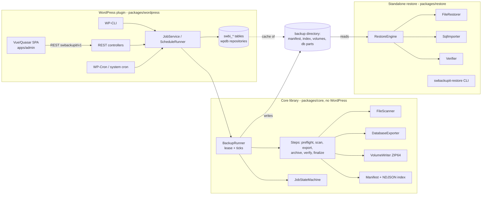

# Architecture

## Components



* `packages/core` (`SWBackupIt\Core`): framework independent. Interfaces for persistence (`JobRepositoryInterface`,
  `JobEventStoreInterface`), source description (`SourceInfoProviderInterface`) and events.
* `packages/restore` (`SWBackupIt\Restore`): reads backups only; shares the format classes of core. Distributed as a
  self-contained directory (`bin/build-restore.sh`), no Composer/WordPress needed.
* `packages/wordpress` (`SWBackupIt\WordPress`): the only code that touches WordPress APIs.
* `apps/admin`: Vue 3 + Quasar + Vite + TypeScript SPA, compiled to `assets/admin` (no Node on the target).

Dependencies point inwards: wordpress → core ← restore.

## Directory structure

```
swbackupit.php, uninstall.php      plugin bootstrap
packages/core/src                  Archive, Backup(+Step), Database, Domain, Event, Exception, Job, Log, Manifest, Scanner, Support
packages/restore/src               Backup, Cli, Config, Files, Sql, RestoreEngine
packages/restore/bin               swbackupit-restore
packages/wordpress/src             Admin, Cli, Database, Repository, Rest, Runner, Support
apps/admin                         SPA sources
tests/{Unit,Integration,E2e,wp}    PHPUnit (wp = WordPress integration, own Composer env)
docs/                              this documentation, REST contract, plans
bin/                               build and test helper scripts
```

## Dependencies

`league/flysystem` (storage abstraction), `maennchen/zipstream-php` (streamed ZIP64), `psr/log`,
`dragonmantank/cron-expression`; PHP extensions `zip`, `zlib`, `hash`, `json`, `pdo_mysql` (+ `sodium` for encryption).

## Data model (WordPress tables, prefix `{$wpdb->prefix}swbi_`)

`profiles`, `schedules`, `jobs` (JSON entity + lease/flags columns), `job_events`, `backups` (catalog cache),
`backup_locations` (status per storage target), `storage_targets`. The external manifest stays independent; the catalog
can be rebuilt (`wp swbackupit catalog rebuild`). Schema versions are applied by `Schema::migrate()`.

## Job state machine

```mermaid
stateDiagram-v2
  [*] --> pending
  pending --> preparing
  preparing --> scanning --> exporting --> archiving --> encrypting --> uploading --> verifying
  verifying --> completed
  preparing --> failed
  note right of verifying: steps move between the active states;\nany active state may go to paused, retry_waiting, failed, cancelled
  paused --> preparing: resume (back to the previous state)
  retry_waiting --> preparing: retry after backoff
  failed --> retry_waiting: manual retry
  completed --> [*]
  cancelled --> [*]
```

Execution model: `BackupRunner::tick()` acquires a lease, runs steps until the time budget is exhausted, persists
checkpoints and releases the lease. Resume granularity is the finished (fsynced, renamed) volume / database part / inventory
slice. Lease expiry recovers from crashed workers. Transient errors (`TransientException`) become `retry_waiting` with
exponential backoff + jitter; everything else fails. Pause/cancel are flags consumed between work units.

Steps (`Step` enum, in order): preflight, scan, export, archive, encrypt, verify_local, upload, verify_remote, finalize,
retention, notify. Steps that do not apply to a profile are skipped.

## Events and hooks

Core events (`before_backup`, `after_backup`, `backup_failed`, `before/after_database_export`, `before/after_upload`,
`before/after_restore`, `restore_failed`). `before_*` events may veto via a *blocking* listener (the job fails cleanly with
`swbi_vetoed` before state changes); all other listeners are *isolated* – exceptions are logged and never alter state.
WordPress bridge: action `swbi_<event>`, filter `swbi_allow_<event>` for vetoes.

## Archive format, restore process, storage, security

See `backup-format.md` and `security.md`. Restore: verify → files (atomic, resumable per file, guarded) → database
(streamed, resumable at statement level) → wp-config update → done; the engine never reports success when a phase failed.

## Tests

Unit (value objects, scanner, splitter), integration (job engine, DB roundtrip on a private MariaDB, restore security, CLI,
standalone distribution in a separate process), E2E (backup → wipe → restore), WordPress integration (REST, schema, schedules,
capabilities). Static analysis: PHPStan level 8, PHPCS (PSR-12 core/restore/tests, WPCS for the adapter).
