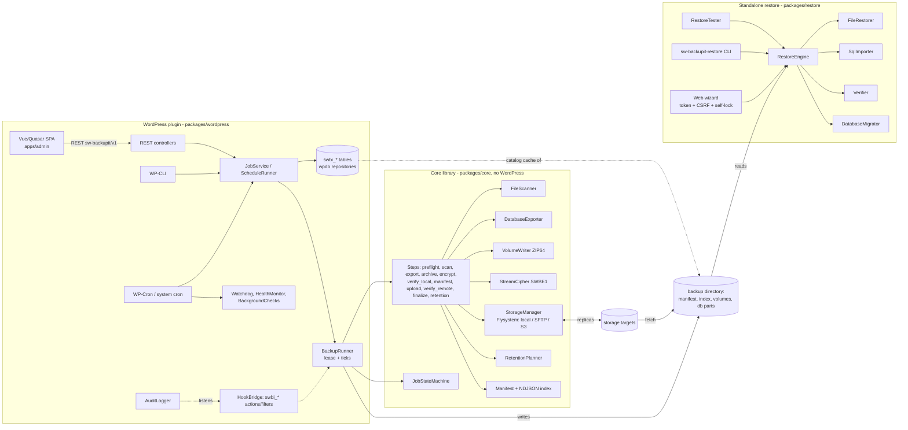

# Architecture

## Components



* `packages/core` (`SWBackupIt\Core`): framework independent. Interfaces for persistence (`JobRepositoryInterface`, `JobEventStoreInterface`),
  source description (`SourceInfoProviderInterface`), storage (`RemoteStorageInterface`, `StorageResolverInterface`), keys
  (`KeyProviderInterface`), the backup catalog (`BackupCatalogInterface`) and events.
* `packages/restore` (`SWBackupIt\Restore`): reads backups only; shares the format classes of core. Distributed as a self-contained directory
  (`bin/build-restore.sh`), no Composer/WordPress needed. Contains the CLI, the web wizard, comparator, migration and the restore tester.
* `packages/wordpress` (`SWBackupIt\WordPress`): the only code that touches WordPress APIs.
* `apps/admin`: Vue 3 + Quasar + Vite + TypeScript SPA, compiled to `assets/admin` (no Node on the target).

Dependencies point inwards: wordpress → core ← restore.

## Directory structure

```
sw-backupit.php, uninstall.php      plugin bootstrap
packages/core/src                  Archive, Backup(+Step), Crypto, Database, Domain, Event, Exception, Job, Log, Manifest, Retention, Retry, Scanner, Storage, Support
packages/restore/src               Backup, Cli, Config, Files, Migration, Sql, Testing, Web, RestoreEngine
packages/restore/public            web wizard entry point and assets (copied into restore-app/)
packages/wordpress/src             Admin, Cli, Database, Repository, Rest, Runner, Support
apps/admin                         SPA sources
tests/{Unit,Integration,E2e,Load}  PHPUnit (Load = separate suite)  ·  tests/wp: WordPress integration (own Composer env, single + multisite)
docs/                              documentation, REST contract, plans
bin/                               build and test helper scripts (ZIP, restore app, private MariaDB, S3 mock)
```

## Dependencies

`league/flysystem` (+ local, aws-s3-v3, sftp-v3), `aws/aws-sdk-php` (via the S3 adapter), `phpseclib` (SFTP), `maennchen/zipstream-php`
(streamed ZIP64), `psr/log`, `dragonmantank/cron-expression`; PHP extensions `zip`, `zlib`, `hash`, `json`, `pdo_mysql` (+ `sodium` for encryption).

## Data model (tables `{$wpdb->base_prefix}swbi_*`; network wide on multisite)

`profiles`, `schedules`, `jobs` (JSON entity + lease/flags columns), `job_events`, `backups` (catalog cache incl. chain info and last restore test),
`backup_locations` (status per storage target), `storage_targets` (credentials encrypted), `audit` (append-only). The external manifest stays
independent; the catalog can be rebuilt from storage (`discover/import`) or the staging directory (`wp sw-backupit catalog rebuild`).
Schema versions are applied by `Schema::migrate()` (v1 base tables, v2 audit). Multisite: all data and settings are network options/tables on the
main site, one cron watcher per network, UI in the Network Admin, a backup always covers the whole network (selective restore of single sites is a future stage).

## Job state machine

```mermaid
stateDiagram-v2
  [*] --> pending
  pending --> preparing
  preparing --> scanning --> exporting --> archiving --> encrypting --> verifying --> uploading
  uploading --> verifying: remote verification
  verifying --> completed
  preparing --> failed
  note right of verifying: steps move between the active states;\nany active state may go to paused, retry_waiting, failed, cancelled
  paused --> preparing: resume (back to the previous state)
  retry_waiting --> preparing: retry after backoff
  failed --> retry_waiting: manual retry
  completed --> [*]
  cancelled --> [*]
```

Execution model: `BackupRunner::tick()` acquires a lease, runs steps until the time budget is exhausted, persists checkpoints and releases the lease. Resume
granularity is the finished (fsynced, renamed) volume / database part / encrypted file / uploaded file (S3: multipart part) / inventory slice. Lease expiry
recovers from crashed workers; a worker renews its lease before every checkpoint write and aborts its tick without touching the job
when the lease was taken over (a step blocked longer than the lease), the watchdog restarts lost jobs and fails jobs that made no progress for 48 h. Transient errors (`TransientException`)
become `retry_waiting` with exponential backoff + jitter; everything else fails. Pause/cancel are flags consumed between work units.

Steps (`Step` enum, in order): preflight, scan, export, archive, encrypt, verify_local, manifest, upload, verify_remote, finalize, retention, notify.
Steps that do not apply to a profile are skipped. Order rationale: the manifest is written after all artifacts exist and are verified locally, so remote copies can
include it (uploaded last); `finalize` decides success according to the profile's success policy.

## Events and hooks

See `hooks.md`. `before_*` events may veto (blocking listener, clean failure before state changes); everything else is isolated.

## Archive format, restore process, storage, security

See `backup-format.md` and `security.md`. Restore: verify → files (atomic, resumable per file, guarded) → database (streamed, resumable at statement level)
→ URL/prefix migration (transactional progress) → wp-config update → done; the engine never reports success when a phase failed.
The resume state is bound to a fingerprint of the request (backup, target, database, selection, options): a different restore never
continues an old state. After a file failure the file phase starts over on the next run (identical files are skipped), so failed
entries are retried instead of being skipped. Notes for the user (skipped symlinks, files that changed during the backup, wp-config
constants that could not be rewritten) are part of the result.

## Tests

Unit (value objects, scanner, splitter, retention, crypto, serialized replacer), integration (job engine, DB roundtrip on a private MariaDB, storage incl. S3
mock + multipart resume, restore security, CLI, web wizard, migration, comparator, restore tester, retention step, standalone distribution in a separate
process), E2E (backup → wipe → restore, encrypted multi-target, incremental/differential chains), load (20,000 files, 300 MB file, concurrent workers, full disk),
WordPress integration (REST, schema, schedules, capabilities, audit, pre-update, watchdog, multisite, security regressions). Static analysis: PHPStan level 8,
PHPCS (PSR-12 core/restore/tests, WPCS for the adapter), ESLint/vue-tsc/Vitest for the SPA.
